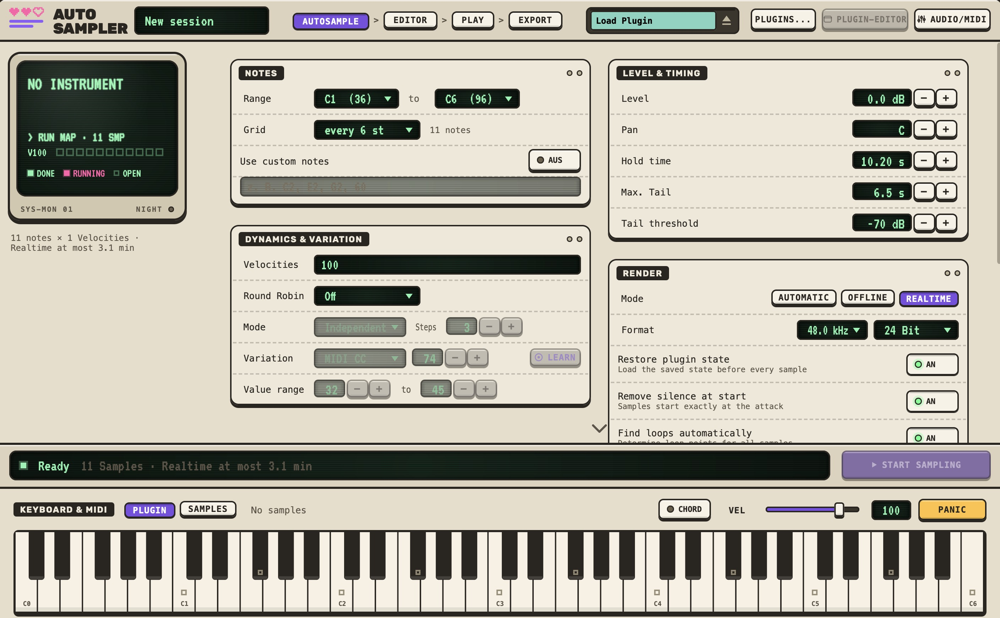

# Autosampler

Autosampler is a native macOS app for Apple Silicon. It automatically records VST3 and AU
instruments as multisamples (notes, velocity layers, round robin), finds loops in the
recordings, can be played live, and exports the result as a sampler instrument
(WAV with metadata, SFZ, Elektron Tonverk).



Version 1.0.3 · macOS 13+ · arm64 · C++20 with [JUCE](https://juce.com) 9.0.4

## Installation

Requirements: Xcode (Command Line Tools), [CMake](https://cmake.org) ≥ 3.25 and [Ninja](https://ninja-build.org).

```bash
brew install cmake ninja
```

Get the source and build (CMake downloads JUCE itself on the first configure):

```bash
git clone <repository-URL> autosampler
cd autosampler
git switch release/1.0.0

cmake -S . -B build -G Ninja -DCMAKE_BUILD_TYPE=Release
cmake --build build --target Autosampler
```

## Running

```bash
open build/Autosampler_artefacts/Release/Autosampler.app
```

You can optionally copy the app to `/Applications`. Since it is signed ad hoc locally,
macOS may prompt on the first launch (right-click → Open).

Then load an installed VST3 or AU instrument, choose notes and velocities in the
**Autosample** tab, and start sampling.

## Changelog

### 1.0.3

- ui-fixes

### 1.0.2

- Keyboard & MIDI: Auto-change, Playmode-colours

## License

AGPL-3.0, see [LICENSE](LICENSE). The fonts in `Resources/Fonts` are licensed under the
SIL Open Font License.

## Support

if you like this project, 
[Support me](https://buymeacoffee.com/msobo)
